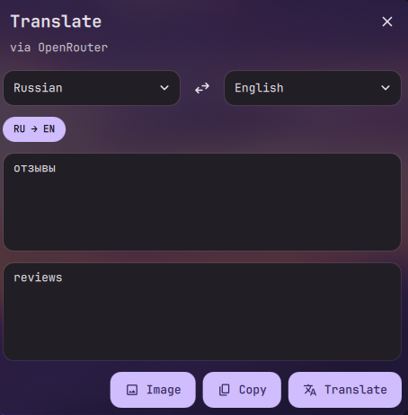

# DMS Translate

[English](README.md) | Русский

Небольшой виджет-переводчик для верхней панели [DankMaterialShell](https://github.com/duxlabs-dev/dux-shell) 1.6.3+ и Dux Shell 2.x. Нажмите на иконку, введите или вставьте текст, нажмите Enter. Работает с Google Cloud Translation, DeepL или любой моделью OpenRouter. Чистый QML: без Python и дополнительных пакетов.



## Требования

- DankMaterialShell 1.6.3 или новее либо Dux Shell 2.x (проверено на niri)
- API-ключ одного из провайдеров (см. [Провайдеры и ключи](#провайдеры-и-ключи))

## Установка

```bash
git clone https://github.com/exec-cmd/dms-translater.git
cd dms-translater
./install.sh
dms ipc call plugins reload dmsTranslate
```

`install.sh` копирует `src/` в `~/.config/dms/plugins/dmsTranslate` на Dux Shell 2.x или в `~/.config/DankMaterialShell/plugins/dmsTranslate` на 1.x. С `--link` вместо копии создаётся симлинк, и правки в репозитории применяются после перезагрузки плагина. Существующий каталог другого плагина без `--force` не заменяется.

## Добавление на панель

1. Settings → Plugins → Scan for Plugins, затем включите **Translate**.
2. В настройках плагина выберите провайдера и введите его API-ключ.
3. Settings → Dank Bar → добавьте виджет **Translate** в нужную секцию.

В окне перевода Enter запускает перевод, Shift+Enter добавляет новую строку. В списках языков работает поиск: просто начните печатать. Язык источника может быть Auto. Кнопка обмена меняет языки местами и переносит последний перевод в поле ввода. Четыре последние использованные пары языков показаны чипами под списками, переключение в один клик. Текущая пара запоминается.

Чтобы перевести текст на картинке, скопируйте её (например, скриншот niri) и нажмите Ctrl+V в поле ввода или кнопку **Image**. Картинки работают только с OpenRouter и моделью, которая принимает изображения (модель по умолчанию `z-ai/glm-5.3-flash` принимает). Google Cloud Translation v2 и DeepL `/v2/translate` принимают только текст. Для вставки картинки нужен `wl-paste` из wl-clipboard.

## Провайдеры и ключи

| Провайдер | Ключ | Примечания |
|---|---|---|
| Google Cloud Translation | [Cloud Console](https://console.cloud.google.com/apis/credentials), с включённым Cloud Translation API | Используется Basic v2 API, он принимает API-ключи. |
| DeepL | [Аккаунт DeepL API](https://www.deepl.com/your-account/keys) | Бесплатные ключи заканчиваются на `:fx` и автоматически идут на `api-free.deepl.com`. |
| OpenRouter | [openrouter.ai/keys](https://openrouter.ai/keys) | Модель по умолчанию `z-ai/glm-5.3-flash`. Id модели, уровень размышлений и системный промпт можно изменить. **Reasoning**: Model default ничего не отправляет; от Off до Extra high задают `reasoning.effort` (Off быстрее всего; модели, которые размышляют всегда, могут его отклонить). `{source}` и `{target}` в промпте заменяются названиями языков. |

API-ключи хранятся **открытым текстом** в `plugin_settings.json` шелла (в `~/.config/dms/` или `~/.config/DankMaterialShell/`), и этот файл может прочитать любой плагин. Используйте ключи, ограниченные API перевода, с лимитом расходов. Ключи передаются только в заголовках запросов, никогда в URL или командной строке.

Переводимый текст отправляется выбранному провайдеру.

## Горячая клавиша

Добавьте бинд в `~/.config/niri/config.kdl`:

```kdl
binds {
    Mod+Alt+T { spawn "dms" "ipc" "call" "widget" "toggle" "dmsTranslate"; }
}
```

Чтобы клавиша работала, виджет должен быть на панели.

## Обновление и удаление

```bash
git pull && ./install.sh   # с --link не нужно, достаточно перезагрузки
./uninstall.sh
```

`uninstall.sh` удаляет только каталог плагина. Настройки и ключи остаются в `plugin_settings.json` под `dmsTranslate`; при необходимости удалите эту запись вручную.

## Разработка

```bash
node --test tests/*.test.mjs              # сборка запросов и разбор ответов
shellcheck install.sh uninstall.sh
./install.sh --link && dms ipc call plugins reload dmsTranslate
```

Правила репозитория описаны в [AGENTS.md](AGENTS.md).

## Лицензия

MIT. См. [LICENSE](LICENSE).
